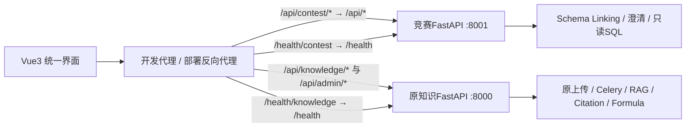

# 竞赛整合：方案B

## 当前交付

工作基线为本地`feat/contest-integration`，阶段1从`9507c2f`实施并由用户提交至`42d0743`，后续以该本地工程为基础；参考目录为`D:\python project\dkf_agent_integration_patch`。阶段1静态检查完成，人工回归及GPU Reindex仍待验收。阶段2后端已交付，自动测试（含类型兼容修复复测）和真实联调仍待用户验收。阶段3已编写Vue3/TypeScript工作台、双服务开发代理及隔离测试，但未安装npm依赖、执行测试/typecheck/构建、启动服务或真实联调。不得修改或合并到main，不自动暂存、提交或推送。

原FastAPI、PostgreSQL/pgvector、Redis/Celery、MinerU、LlamaIndex、RAG、Citation、Formula及有限LangGraph Knowledge Agent继续保留。知识阶段33全200文档/4087题仍待验收，竞赛阶段1完成不改变该结论。

## 9522356的选择清单

源提交共18个文件，其中包含一份1,698,354字节的补丁ZIP。逐项审阅后仅移植下列直接相关变更；原目标文件与提交父版本一致后才移植，没有merge或整提交cherry-pick。

| 文件 | 处理及原因 |
|---|---|
| `app/parsers/routing/inspector.py` | 移植DOCX官方外部排版模板例外及XML资源超限安全诊断 |
| `app/parsers/hybrid.py` | 移植XLSX包内customXml官方关系兼容，保留缺件/越界保护 |
| `app/services/routed_processing.py` | 移植Hybrid实际终止错误码优先，避免展示启用标记作为错误 |
| `app/services/chunk/splitter.py` | 移植v4 Native TSV逻辑行和有限大表切片，保留v1～v3冻结行为 |
| `app/services/chunk/processing.py` | 移植与切片版本一致的源字符预检和安全失败摘要 |
| `app/services/mineru/table_html.py` | 移植显式TableLimits及可选单元格p兼容，Adapter默认预算不变 |
| `app/core/business_logging.py` | 移植预检拒绝事件，复用原白名单/每日共享日志，不新增进程角色 |
| `tests/test_stage33_office_recovery.py` | 移植Office正反例与预检/终止原因回归，仅编写未执行 |
| `tests/test_chunk_table_rows.py`、`tests/test_document_management.py` | 移植新旧切片版本、TSV/HTML和Reindex检查点用例 |
| `README.md`及`docs/BUSINESS_LOGGING.md`、`CHUNK.md`、`PARSER_ROUTER.md`、`SELECTIVE_HYBRID.md` | 移植上述修复的通用行为说明，并修正新Reindex版本描述 |
| `AGENTS.md`、`docs/STAGE33_EVALUATION.md` | 仅局部维护规则/修复与人工步骤；不复制源提交的新统计或逐文档UUID恢复记录 |
| `dkf_agent_integration_patch.zip` | 排除，不把交付压缩包带入源码 |

缓存、测试产物、数据库数据、文档原件和模型均不移植；真实`.env`未读取正文或修改。未增加依赖或环境变量，无需环境同步。`.gitignore`只放行本次两份工程文档。

本阶段新增`contracts/__init__.py`、`contracts/contest_v1.py`、`contracts/tools.py`和`tests/test_contest_contract.py`。前者只依赖标准库、既有Pydantic及原纯Schema，不导入运行应用、注册路由或连接数据库/模型。

## 双服务边界与参考代码冲突



第二服务代码在阶段2实现；阶段3已编写Vue3及开发代理，均待用户运行验收。代理分别精确匹配contest、knowledge、admin，避免通用/api截获问数；双健康检查各自转发真实/health。Vite只提供开发代理，生产需由用户部署反向代理。第二服务不复制上传、Parser、向量存储、RAG或公式引擎。

| 参考代码的实际问题 | 后续整合处理 |
|---|---|
| `workflow._query`未把confirmed_slots交给pipeline | 从已认证会话恢复槽位，显式传入Linking、生成、修复及结果证据；禁止直接信任客户端槽位 |
| Schema歧义返回needs_user，却被workflow归为执行失败 | 映射needs_clarification，保存候选与问题版本，确认前不生成/执行SQL |
| 独立Text2SQL与对话Trace不共享身份 | 请求入口创建唯一request/run/trace；所有工具继承上下文，不维护进程全局last_trace |
| catalog/pipeline硬编码注册表；mapping交付路径不一致 | 使用同一服务端配置解析注册表及Schema快照；缺失即不可用，不按工作目录猜路径 |
| auto提供方、额外重试、未显式授权修复 | 采用冻结云许可/预算，默认零调用；无传输重试或自动Fallback，最多一次另行许可的SQL修复 |
| Trace JSON含原问题/输入/输出、错误含模型原文 | UI执行证据与业务日志分开；日志只含白名单身份/数量/耗时，Trace按会话鉴权，不能保存原文运行快照 |
| 前端失败后保留Chinook选项、文档/Block只取首屏、旧文档RAG | 数据目录来自真实API，失败显示不可用；支持分页、真实上传状态与原RAG/Citation；删除冒充成功的数据 |
| 参考包包含独立RAG、OCR、Embedding、公式实现 | 不接入正式知识链路；只消费原服务接口或后续薄适配器 |

阶段2已编写语法树校验、Schema/表列/函数允许集、只读账号/事务、实际表及外键核验、固定search_path、默认15秒且最高30秒statement_timeout与最多500行展示；禁止客户端DSN、文件路径及任意表授权。DTO本身不提供执行保证，运行验收仍待用户完成。

## 阶段2交付

文件清单、参考能力的选择性适配、配置项、API/DTO映射、安全限制及完整手工步骤见[竞赛后端说明](CONTEST_BACKEND.md)。公共`contracts/`无修改，仅适配既有SQLTool/ClarificationTool边界；知识代码仅追加必要日志元数据。用户已同意声明参考包已有的`sqlglot>=26.33,<27`，未安装；不引入psycopg2/networkx，不执行数据库查询/模型/pytest。

`main/f4b092e`只读审阅完成：旧Office缓存离线升级、分组恢复及冻结版本日志不是SQL前置修复，本轮不移植；没有merge/cherry-pick。阶段1及知识阶段33的待验收结论不改变。竞赛状态仅为代码已编写，不能称真实问数、费用控制或GPU已验收。

## 后续实施阶段

| 阶段 | 实施范围 | 验收门槛 |
|---|---|---|
| 1 | 必要修复、版本化契约和四Tool边界已实施 | 静态检查完成；定向人工回归/单文档GPU Reindex仍待验收 |
| 2 | 独立contest_backend、目录/只读SQL/费用、意图/Linking/澄清/Trace已交付 | 自动测试及真实权限/表格/条件/外键/费用/Trace仍待用户验收 |
| 3（本次） | Vue3/TypeScript、双服务同源开发代理、问数/SQL/知识/上传管理/证据/Trace及人工跨源联动已编写 | 依赖安装、typecheck、隔离测试、构建和真实浏览器联调均待用户执行 |
| 4（后续） | 薄适配、手工联调与赛题演示说明 | 用户授权范围内人工端到端验收；未实现能力明确标记，无自动跨源规划器 |

统一Agent暂时只有[契约与设计](CONTEST_API_CONTRACT.md)，不新增Coordinator运行时，不重构原Knowledge Agent；未来启用统一入口需另立实现阶段。

阶段3的文件清单、参考前端复用说明、实际API/DTO对应、环境变量和完整人工步骤见[前端交付与验收](CONTEST_FRONTEND.md)。浏览器令牌/会话私钥及业务内容仅在内存，不自动重发收费请求；不勾选上传许可时显式native，不把前端勾选当后端权限。没有开发统一Agent、第二套RAG/Formula/向量库，也未修改app、contest_backend或公共Python契约。本轮完成阶段3后停止等待用户确认。

## 阶段1人工验收

以下命令只供用户执行，Codex未运行。先在项目根目录进入已有`dkf-agent`环境：

```powershell
conda activate dkf-agent
python -m pytest tests/test_contest_contract.py -q -ra
python -m pytest tests/test_stage33_office_recovery.py tests/test_chunk_table_rows.py tests/test_chunk_splitter.py tests/test_document_management.py tests/test_parser_router.py tests/test_hybrid.py tests/test_parse_cache.py tests/test_business_logging.py -q -ra
```

预期：契约拒绝空范围、未授权预算、客户端伪造槽位、错run澄清、无执行凭证的成功、执行未知后重放、非有限Trace耗时及敏感额外字段；原修复回归覆盖Office例外与安全反例、长表来源/版本兼容。缺依赖或跳过不等于验收通过，不能据此断言真实SQL/云服务已可用。

真实知识恢复只选一份已有成功缓存、无活动任务的文档，由用户备份并按[阶段33移植验收](STAGE33_EVALUATION.md#竞赛分支选择性移植待人工验收)执行Reindex。预期不新增MinerU批次，不改变原页码/质量，生成v4检查点并由原Worker完成GPU/Index；超长不可拆行仍可明确失败。未做全库导入、阶段33质量评测、SQL运行、云调用或前端验收。

后续仍由用户手动安装/部署基础服务、启动API/Worker、执行迁移和验收。任何付费验收须另行明确接收方、样本、预算与次数，不能从本阶段实施授权推导测试授权。
